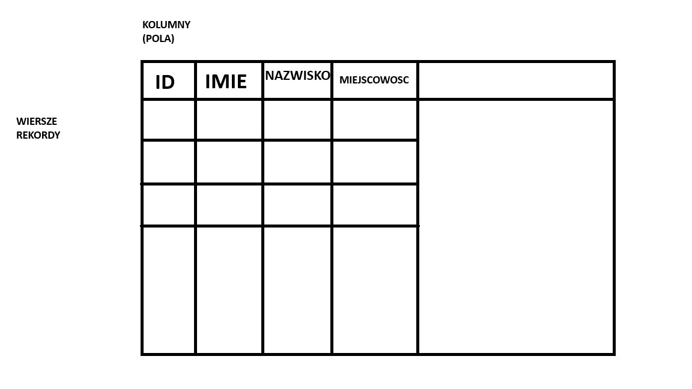

# Lekcja 1 — tworzenie tabel w Accessie

Materiały z pierwszej lekcji: notatka, przykład bazy danych oraz zdjęcia używane w ćwiczeniu.

## Pliki Access

- [PierwszaBaza.accdb — pierwsza baza](lekcja1/PierwszaBaza.accdb)
- [DrugaBaza.accdb — druga baza](lekcja1/DrugaBaza.accdb)

## Notatka i materiały

- [Otwórz notatkę z lekcji](lekcja1/bazy_danych_1.md)
- [Zobacz obraz z poleceniem](lekcja1/bazy_danych_1.png)

## Zdjęcia

- [cini.jpg](lekcja1/cini.jpg)
- [kamil.jpg](lekcja1/kamil.jpg)
- [Fiat.jpg](lekcja1/Fiat.jpg)
- [Ford.jpg](lekcja1/Ford.jpg)
- [Infiniti.jpg](lekcja1/Infiniti.jpg)
- [Jaguar.jpg](lekcja1/Jaguar.jpg)
- [Mercedes-Benz.jpg](lekcja1/Mercedes-Benz.jpg)
